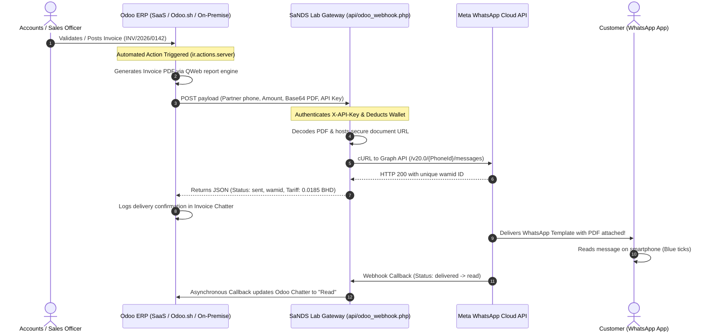

# Odoo ERP & WhatsApp Integration Platform — Step-by-Step Setup Guide
*Engineered by SaNDS Lab Middle East W.L.L. | Version 2.3.0*

---

## 📌 Document Overview

This document provides a comprehensive, step-by-step setup procedure for connecting **Odoo ERP (v14, v15, v16, v17, and v18)** to the **SaNDS Lab WhatsApp Integration Platform** (`https://whatsapp.sandslab.com`).

By following this guide, your Odoo instance will automatically:
1. **Send Instant WhatsApp Notifications** when invoices, sales orders, delivery slips, or payment receipts are created/posted.
2. **Attach Real Dynamic PDF Documents** (e.g., official Tax Invoices or Quotations) streamed directly into the customer's WhatsApp chat.
3. **Log Audit & Delivery Receipts** back to the Odoo document Chatter (confirming dispatch timestamp, WhatsApp tracking ID `wamid`, and delivery status).
4. **Require ZERO External Python Libraries** (runs natively on standard Odoo SaaS, Odoo.sh, or on-premise installations).

---

## 🏗️ Architecture & Communication Flow



---

## 🔑 Integration Credentials & Endpoints

| Parameter | Value | Description |
|---|---|---|
| **Platform Gateway URL** | `https://whatsapp.sandslab.com` | Base URL of WhatsApp Platform |
| **Odoo Webhook Endpoint** | `https://whatsapp.sandslab.com/api/odoo_webhook.php` | Main endpoint for Odoo automated actions |
| **HTTP Method** | `POST` | All dispatches must use HTTP POST |
| **Authentication Header** | `X-API-Key: sk_live_odoo_uniglobal_98741362` | Master API Key for Odoo Production |
| **Content-Type** | `application/json` | Payloads must be valid JSON |
| **Supported Odoo Models** | `account.move`, `sale.order`, `account.payment`, `stock.picking` | Core standard business models |

> [!TIP]
> You can view or regenerate API keys anytime in the platform under **API Keys** (`https://whatsapp.sandslab.com/#api_keys`).

---

## 🚀 Step 1: Activate Developer Mode in Odoo

To configure Automated Server Actions, you must first activate **Developer Mode** in your Odoo database:

1. Log in to your Odoo instance as an **Administrator**.
2. Open the **Settings** application.
3. Scroll to the bottom of the General Settings page.
4. Click **Activate the developer mode** (or **Activate developer mode with assets**).
5. A bug icon 🪲 will appear in the top right header, confirming Developer Mode is active.

---

## 🚀 Step 2: Configure Server Action for Customer Invoices (`account.move`)

We will create a Server Action that executes standard Python code whenever a customer invoice is validated.

### 2.1 Navigate to Server Actions
- Go to: **Settings → Technical → Actions → Server Actions**
- Click **New** (or **Create**).

### 2.2 Configure Action Header
- **Action Name:** `Send WhatsApp Tax Invoice with PDF`
- **Model:** `Journal Entry` / `account.move`
- **Action To Do:** Select **Execute Python Code**

### 2.3 Insert the Python Script
Paste the following complete script into the **Python Code** editor:

```python
# ==============================================================================
# SaNDS Lab WhatsApp Gateway — Odoo Automated Server Action
# Model: account.move | Trigger: On Invoice Validate / Post
# Zero external pip packages required (Standard Python library)
# ==============================================================================
import json
import urllib.request
import base64

API_GATEWAY_URL = "https://whatsapp.sandslab.com/api/odoo_webhook.php"
API_SECRET_KEY  = "sk_live_odoo_uniglobal_98741362"

# 1. Check if the record is a Customer Invoice (not a Vendor Bill)
if record.move_type in ('out_invoice', 'out_refund'):
    partner = record.partner_id
    
    # 2. Resolve destination phone (Check mobile first, then phone)
    dest_phone = (partner.mobile or partner.phone or "").strip()
    
    if not dest_phone:
        record.message_post(
            body="⚠️ <b>WhatsApp Skipped:</b> Customer has no mobile or phone number in contact card."
        )
    else:
        # 3. Dynamic PDF Generation via Odoo QWeb Report Engine
        pdf_base64 = None
        try:
            report_ref = record.env.ref('account.account_invoices', raise_if_not_found=False)
            if report_ref:
                pdf_binary, _ = report_ref._render_qweb_pdf([record.id])
                pdf_base64 = base64.b64encode(pdf_binary).decode('utf-8')
        except Exception as pdf_err:
            pdf_base64 = None

        # 4. Prepare JSON Payload
        curr_name = record.currency_id.name if record.currency_id else "BHD"
        inv_date  = str(record.invoice_date or record.create_date.date())
        
        payload = {
            "model": "account.move",
            "record_id": record.id,
            "record_name": record.name or f"INV-{record.id}",
            "partner_name": partner.name or "Valued Customer",
            "partner_phone": dest_phone,
            "amount": record.amount_total,
            "currency": curr_name,
            "date": inv_date,
            "template_name": "uniglobal_invoice_notification",
            "pdf_base64": pdf_base64,
            "callback_url": "https://whatsapp.sandslab.com/api/odoo_webhook.php?action=simulate_callback"
        }

        # 5. Dispatch HTTP POST to SaNDS Lab Gateway
        req = urllib.request.Request(
            API_GATEWAY_URL,
            data=json.dumps(payload).encode('utf-8'),
            headers={
                "Content-Type": "application/json",
                "X-API-Key": API_SECRET_KEY,
                "User-Agent": "Odoo-WhatsApp-Connector/2.3"
            },
            method="POST"
        )

        try:
            with urllib.request.urlopen(req, timeout=15) as response:
                res_data = json.loads(response.read().decode('utf-8'))
                if res_data.get('success'):
                    wamid = res_data.get('message_id', '')
                    tariff = res_data.get('tariff', {}).get('client_rate', '')
                    record.message_post(
                        body=f"✅ <b>WhatsApp Invoice Dispatched</b><br/>"
                             f"📱 Recipient: <b>{dest_phone}</b><br/>"
                             f"📄 Template: <code>{res_data.get('template_name')}</code><br/>"
                             f"🆔 Meta ID: <code>{wamid}</code><br/>"
                             f"💳 Tariff: <b>{tariff}</b>"
                    )
                else:
                    err_msg = res_data.get('error') or res_data.get('message') or 'Unknown error'
                    record.message_post(body=f"❌ <b>WhatsApp Dispatch Failed:</b> {err_msg}")
        except Exception as ex:
            record.message_post(body=f"❌ <b>WhatsApp Gateway Error:</b> {str(ex)}")
```

### 2.4 Click Save
Click the **Save** button (Cloud icon or Save button in Odoo). Note the ID of this Server Action.

---

## 🚀 Step 3: Configure the Automation Trigger (Automated Rule)

Now we connect the Server Action to fire automatically when the Invoice state changes to `Posted`.

### Option A: For Odoo 17 & 18 (Automation Rules)
1. Go to: **Settings → Technical → Automation Rules**
2. Click **New**:
   - **Rule Name:** `Auto WhatsApp on Invoice Post`
   - **Model:** `Journal Entry` (`account.move`)
   - **Trigger:** Select **On Save** or **On Stage Change**
   - **Trigger Fields:** Add `State` (`state`)
   - **Before Update Domain:** `["state", "!=", "posted"]`
   - **Apply On (Filter Domain):** `[["state", "=", "posted"], ["move_type", "=", "out_invoice"]]`
   - **Action To Do:** Select **Execute an action** → choose `Send WhatsApp Tax Invoice with PDF`.
3. Click **Save**.

### Option B: For Odoo 14, 15, and 16 (Automated Actions)
1. Go to: **Settings → Technical → Automation → Automated Actions**
2. Click **Create**:
   - **Action Name:** `Auto WhatsApp on Invoice Post`
   - **Model:** `Journal Entry` (`account.move`)
   - **Trigger:** Select **On Creation & Update**
   - **Trigger Field:** Select `State` (`state`)
   - **Before Update Filter:** `[('state', '!=', 'posted')]`
   - **Apply On:** `[('state', '=', 'posted'), ('move_type', '=', 'out_invoice')]`
   - **Action To Do:** Select **Execute Python Code** (or link to the Server Action created in Step 2).
3. Click **Save**.

---

## 🚀 Step 4: Configure for Sales Quotations & Orders (`sale.order`)

To automatically notify customers whenever a Sales Order is confirmed:

1. Go to: **Settings → Technical → Actions → Server Actions** → **New**.
2. **Action Name:** `Send WhatsApp Sales Order Confirmation`
3. **Model:** `Sales Order` (`sale.order`)
4. **Action To Do:** `Execute Python Code`
5. **Python Code:**

```python
import json
import urllib.request
import base64

API_GATEWAY_URL = "https://whatsapp.sandslab.com/api/odoo_webhook.php"
API_SECRET_KEY  = "sk_live_odoo_uniglobal_98741362"

partner = record.partner_id
dest_phone = (partner.mobile or partner.phone or "").strip()

if dest_phone:
    pdf_base64 = None
    try:
        report_ref = record.env.ref('sale.action_report_saleorder', raise_if_not_found=False)
        if report_ref:
            pdf_binary, _ = report_ref._render_qweb_pdf([record.id])
            pdf_base64 = base64.b64encode(pdf_binary).decode('utf-8')
    except Exception:
        pdf_base64 = None

    payload = {
        "model": "sale.order",
        "record_id": record.id,
        "record_name": record.name,
        "partner_name": partner.name,
        "partner_phone": dest_phone,
        "amount": record.amount_total,
        "currency": record.currency_id.name if record.currency_id else "BHD",
        "date": str(record.date_order.date()),
        "template_name": "uniglobal_delivery_dispatch",
        "pdf_base64": pdf_base64
    }

    req = urllib.request.Request(
        API_GATEWAY_URL,
        data=json.dumps(payload).encode('utf-8'),
        headers={"Content-Type": "application/json", "X-API-Key": API_SECRET_KEY},
        method="POST"
    )

    try:
        with urllib.request.urlopen(req, timeout=15) as resp:
            data = json.loads(resp.read().decode('utf-8'))
            if data.get('success'):
                record.message_post(body=f"✅ WhatsApp Order Confirmation Sent: <code>{data.get('message_id')}</code>")
    except Exception as ex:
        record.message_post(body=f"❌ WhatsApp Order Error: {str(ex)}")
```

6. Link this Server Action to an Automation Rule triggered on `state == 'sale'`.

---

## 🚀 Step 5: Configure for Payment Receipts (`account.payment`)

To send an instant WhatsApp payment acknowledgement when customer payment is registered:

1. Model: `account.payment`
2. Trigger: `state == 'posted'`
3. Python Script:

```python
import json
import urllib.request

API_GATEWAY_URL = "https://whatsapp.sandslab.com/api/odoo_webhook.php"
API_SECRET_KEY  = "sk_live_odoo_uniglobal_98741362"

partner = record.partner_id
dest_phone = (partner.mobile or partner.phone or "").strip()

if dest_phone and record.payment_type == 'inbound':
    payload = {
        "model": "account.payment",
        "record_id": record.id,
        "record_name": record.name,
        "partner_name": partner.name,
        "partner_phone": dest_phone,
        "amount": record.amount,
        "currency": record.currency_id.name if record.currency_id else "BHD",
        "date": str(record.date),
        "template_name": "uniglobal_invoice_notification"
    }

    req = urllib.request.Request(
        API_GATEWAY_URL,
        data=json.dumps(payload).encode('utf-8'),
        headers={"Content-Type": "application/json", "X-API-Key": API_SECRET_KEY},
        method="POST"
    )
    try:
        with urllib.request.urlopen(req, timeout=15) as resp:
            data = json.loads(resp.read().decode('utf-8'))
            if data.get('success'):
                record.message_post(body=f"✅ WhatsApp Payment Receipt Dispatched: <code>{data.get('message_id')}</code>")
    except Exception as ex:
        record.message_post(body=f"❌ WhatsApp Payment Error: {str(ex)}")
```

---

## ⚡ Method B: Native No-Code Webhooks (Odoo 17 & 18 Only)

In Odoo 17 and 18, you can also use native **Webhook Actions** without writing any Python:

1. Go to: **Settings → Technical → Automation Rules** → **New**.
2. **Model:** `Journal Entry` (`account.move`)
3. **Trigger:** `On Save` (Filter: `state = 'posted'`)
4. **Action To Do:** Select **Send Webhook Notification**
5. **URL:** `https://whatsapp.sandslab.com/api/odoo_webhook.php`
6. **HTTP Headers:**
   ```
   X-API-Key: sk_live_odoo_uniglobal_98741362
   Content-Type: application/json
   ```
7. **Payload Body:**
   ```json
   {
     "model": "account.move",
     "record_id": "{{ record.id }}",
     "record_name": "{{ record.name }}",
     "partner_name": "{{ record.partner_id.name }}",
     "partner_phone": "{{ record.partner_id.mobile or record.partner_id.phone }}",
     "amount": "{{ record.amount_total }}",
     "currency": "{{ record.currency_id.name }}",
     "date": "{{ record.invoice_date or record.create_date }}",
     "template_name": "uniglobal_invoice_notification"
   }
   ```
8. Save the rule.

---

## 📄 How Dynamic PDF Streaming Works

When an invoice is validated:
1. Odoo executes `_render_qweb_pdf([record.id])`, generating the raw binary PDF file in memory.
2. The Python script encodes this binary into a Base64 string and sends it inside `pdf_base64`.
3. The SaNDS Lab Gateway ([`api/odoo_webhook.php`](file:///e:/integration_with%20oodu_document/whatsapp/api/odoo_webhook.php)) decodes the binary, validates PDF magic bytes (`%PDF-1.4`), and stores it securely in `uploads/odoo_docs/` with unique hash names.
4. The gateway generates an authenticated HTTPS link (e.g. `https://whatsapp.sandslab.com/uploads/odoo_docs/INV_2026_0142_9f2a.pdf`).
5. Meta Cloud API downloads this URL directly and attaches it as a **document header** to the WhatsApp message delivered to the customer's phone!

> [!NOTE]
> The `uploads/odoo_docs/` directory is protected with security directives forbidding the execution of any scripts, allowing only `.pdf`, `.png`, and `.jpg` static downloads by Meta's WhatsApp servers.

---

## 💬 Bi-Directional Delivery Callbacks in Odoo Chatter

When Meta delivers the message to the customer's phone:
1. The customer's WhatsApp client returns a delivery receipt (`delivered` or `read`).
2. Meta calls your webhook listener at `https://whatsapp.sandslab.com/api/webhook.php`.
3. The webhook listener automatically identifies that the message originated from Odoo.
4. If a callback URL is configured, it sends an asynchronous non-blocking POST to your Odoo instance, updating the invoice chatter log:
   ```html
   ✓✓ WhatsApp Delivered to +973 3507 8079 at 12:15:30
   ✓✓ WhatsApp Read by customer at 12:18:10
   ```

---

## 🧪 Testing & Verification Procedure

### Test 1: In-App Webhook Simulator (Zero Risk)
1. Open the platform in your browser: `https://whatsapp.sandslab.com/#api_hub`
2. Click on the **Webhook Tester & Simulator** tab.
3. Click the preset button: **📄 Invoice (INV/2026/0142)**.
4. Set the **Recipient Phone** to your personal test mobile number (e.g., `+97335078079`).
5. Click **▶ Dispatch Simulated Odoo Webhook**.
6. Check your WhatsApp handset — you will receive the notification with the sample PDF attachment in under 2 seconds!
7. Verify that the response inspector displays `HTTP 201 CREATED` with the authentic Meta tracking ID (`wamid`).

### Test 2: Live Odoo End-to-End Test
1. In your Odoo ERP, open **Accounting → Invoices**.
2. Create a new draft customer invoice for a test customer with your mobile number.
3. Add a sample product / line item.
4. Click **Confirm / Post**.
5. Check the **Chatter** at the right side of the invoice screen:
   - You will see the green confirmation banner:
     `✅ WhatsApp Invoice Dispatched | Meta ID: wamid.HBgL...`
6. Check your WhatsApp phone — the notification and Tax Invoice PDF arrive instantly!

---

## 🛠️ Troubleshooting & FAQ

### 1. Customer did not receive WhatsApp message
- **Check Phone Format:** Ensure the customer phone number in Odoo includes the country code (e.g. `+973` for Bahrain, `+966` for Saudi Arabia, `+91` for India). If the number was entered without `+`, the gateway will automatically attempt normalization, but international formatting in Odoo is recommended.
- **Check Wallet Balance:** Make sure your platform wallet has sufficient credit. View balance in **Wallet & Billing** (`#wallet`).

### 2. Odoo Chatter shows: `❌ WhatsApp Gateway Error: HTTP Error 401`
- Verify that the `API_SECRET_KEY` in your Python Server Action matches an active key in `https://whatsapp.sandslab.com/#api_keys`.

### 3. PDF not attaching to the message
- Ensure the WhatsApp template selected has `header_type: 'DOCUMENT'`.
- Verify that the standard Odoo report action exists in your database: `account.account_invoices`.

### 4. Meta Error: `Template not approved`
- Verify that the `template_name` parameter matches an approved template listed under **Templates & Tariffs** (`#templates`).

---

## 📞 Support & Maintenance

Engineered by **SaNDS Lab Middle East W.L.L.**
- **Support Portal:** `https://whatsapp.sandslab.com`
- **Technical Inquiries:** `support@sandslab.com`
- **Documentation Version:** `2.3.0` (Updated: October 2026)
